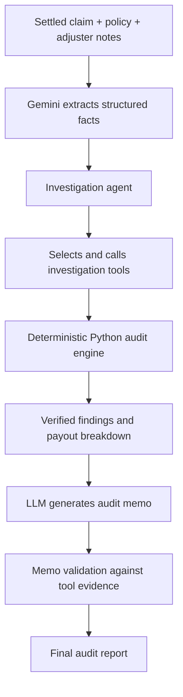

# ClaimsPilot

### An AI-assisted settlement auditor for motor insurance claims

**ClaimsPilot investigates already-settled motor insurance claims to identify incorrect payouts, missed deductions, policy violations, and cases that may require further review.**

It combines an LLM-powered investigation agent with a deterministic Python audit engine. The agent interprets adjuster notes, gathers evidence through tools, and produces an explainable audit memo. Financial calculations and policy checks remain deterministic and independently verifiable.

> **Core design principle:** Let the LLM investigate and explain. Let deterministic code verify the money.

---

## Live Demo

🚀 **[Try ClaimsPilot](YOUR_RENDER_URL_HERE)**

**Repository:** [github.com/sharvari1126/claimspilot](https://github.com/sharvari1126/claimspilot)

---

## Why ClaimsPilot?

A claim can be settled incorrectly even when the final decision appears reasonable.

For example:
- A deductible may have been skipped.
- Depreciation may not have been applied.
- A glass component may have been depreciated incorrectly.
- An exclusion may have been overlooked.
- A suspicious claim may have been paid without further investigation.

ClaimsPilot acts as an independent second-pass auditor. It compares the settled amount against policy rules and available claim evidence, then explains discrepancies with supporting evidence.

## How It Works



## Investigation Workflow

| Stage | What happens |
|---|---|
| 1. Input | The adjuster provides claim details, policy information, settled amount, decision, and notes. |
| 2. Extraction | Gemini converts free-text notes into structured claim facts. |
| 3. Investigation | The agent selects relevant tools and determines the order of investigation. |
| 4. Verification | Deterministic Python rules check coverage, exclusions, fraud indicators, and payout calculations. |
| 5. Diagnosis | The system investigates possible root causes behind payout discrepancies. |
| 6. Reporting | The LLM produces an evidence-backed audit memo, which is validated against tool outputs. |

The investigation agent operates within a bounded number of rounds to prevent uncontrolled tool-calling loops.

## Key Engineering Features

- **Structured information extraction:** Converts unstructured adjuster notes into validated claim data.
- **Tool-using AI agent:** Selects and orchestrates investigation tools instead of relying on a single prompt-response interaction.
- **Deterministic audit engine:** Performs policy checks and payout calculations using Python rules.
- **Root-cause diagnosis:** Tests hypotheses such as missed deductibles, incorrect depreciation, and incorrect component treatment.
- **Evidence-backed reporting:** Validates generated findings against investigation results.
- **Fallback handling:** Supports deterministic extraction and template-based reporting when the LLM is unavailable or its output cannot be validated.
- **Automated testing:** Covers core audit logic, agent behaviour, extraction, and validation.

### Investigation Tools

| Tool | Purpose |
|---|---|
| `get_policy` | Retrieve policy information |
| `get_claim_facts` | Retrieve structured claim facts |
| `get_policy_clause` | Inspect relevant policy clauses |
| `run_audit` | Execute deterministic audit checks |
| `get_payout_breakdown` | Inspect the payout calculation |
| `test_hypothesis` | Test a suspected root cause |

## Tech Stack

| Technology | Role |
|---|---|
| Python | Core application and audit logic |
| FastAPI | Backend API |
| Gemini API | Information extraction and investigation agent |
| Pydantic | Structured data validation |
| pytest | Automated testing |
| HTML, CSS, JavaScript | Web interface |

## Run Locally

### 1. Clone the repository

```bash
git clone https://github.com/sharvari1126/claimspilot.git
cd claimspilot
```

### 2. Create and activate a virtual environment

**Windows PowerShell**

```powershell
python -m venv .venv
.venv\Scripts\Activate.ps1
```

**macOS / Linux**

```bash
python -m venv .venv
source .venv/bin/activate
```

### 3. Install dependencies

```bash
pip install -r requirements.txt
```

### 4. Configure environment variables

Create a `.env` file in the project root:

```env
GEMINI_API_KEY=your_api_key_here
CLAIMSPILOT_MODEL=gemini-3.5-flash-lite
```

Keep API keys private. Never commit `.env` to GitHub.

### 5. Start the application

```bash
uvicorn claimspilot.api:app --reload --app-dir src
```

Open `http://127.0.0.1:8000` in your browser.

## Testing

Run the automated test suite:

```bash
python -m pytest -v
```

**Latest local test result: 108 passing tests.**

The project also includes a synthetic evaluation dataset containing clean claims and claims with deliberately seeded settlement errors. This helps assess whether the audit logic detects known discrepancies.

## Important Limitations

- The project uses synthetic claim and policy data.
- Policy rules are simplified, self-authored examples and do not represent actual insurer policy wording.
- The evaluation dataset is designed for controlled testing, not to establish real-world detection accuracy.
- AI-generated explanations are checked against available tool evidence, but the system is not a substitute for professional claims assessment.
- Final decisions remain with a human claims professional.

## Project Structure

```text
claimspilot/
├── src/
│   └── claimspilot/
│       ├── static/
│       ├── api.py
│       ├── agent.py
│       ├── audit.py
│       ├── extract.py
│       ├── llm.py
│       ├── models.py
│       └── ...
├── tests/
├── scripts/
├── docs/
├── requirements.txt
└── README.md
```
