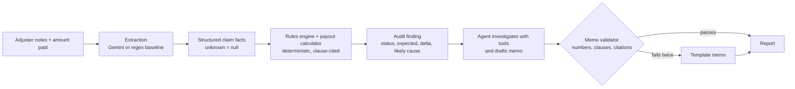

# ClaimsPilot: settlement auditor for motor-insurance claims

Insurers lose money when settled claims are paid wrongly: a deductible skipped, glass depreciated,
a drunk-driving claim paid, a suspicious claim never sent to fraud review. ClaimsPilot re-checks a
settled claim with a **deterministic rules engine**, shows what should have been paid, and works out
**which mistake** explains the amount the adjuster paid. An LLM agent reads the messy adjuster notes and
writes the audit memo, but it never decides whether a payment was right, and its memo is validated
against tool outputs before anyone sees it.

> Prototype on **synthetic data** with **simplified rules** (`data/policy_wording.md`). Decision support only.
> Built with AI assistance (see [Built with AI](#built-with-ai)).

## How it works



| Step | Who does it | Why |
|---|---|---|
| Read free-text notes into facts | LLM (JSON, schema-validated, retried once) | Notes are messy; facts not stated stay `null` |
| Coverage, exclusions, fraud flags, payout | Plain Python, unit-tested | Money must be exact and explainable |
| Compare with what was paid, name the mistake | Plain Python (hypothesis testing) | Reproduce the paid amount under a named mistake |
| Investigate and write the memo | LLM agent, deterministic tools | Narration, not judgment |
| Check the memo | Plain Python validator | Block invented numbers and clauses |

**Root-cause diagnosis.** For an over/underpayment the auditor recomputes the payout under each named
mistake (deductible ignored, applied twice, depreciation skipped, glass depreciated, wrong age bracket) and
reports the ones that reproduce the amount paid *exactly*.

**Agent, precisely.** The LLM chooses which tools to call and in what order (max 8 rounds): `get_policy`,
`get_claim_facts`, `get_policy_clause`, `run_audit`, `get_payout_breakdown`, `test_hypothesis`. The verdict
comes from `run_audit`, which is code. It is a bounded tool-using agent over a deterministic core, not an autonomous one.

## Run it

```bash
python -m venv .venv && source .venv/bin/activate      # Windows: .venv\Scripts\activate
pip install -r requirements.txt
python -m pytest                                        # 97 tests, no API key needed
uvicorn claimspilot.api:app --app-dir src --reload      # open http://127.0.0.1:8000
```

Without an API key the app runs in offline mode (regex reader for the sample notes + template memo).
To Use Gemini, copy `.env.example` to `.env`, set `GEMINI_API_KEY`, restart, and tick **Use Gemini**.

```bash
python scripts/make_dataset.py        # regenerate the 41 synthetic settled claims
python scripts/eval_extraction.py     # add --llm to score Gemini
python scripts/eval_end_to_end.py     # add --llm to score Gemini
```

## Evaluation

Benchmark: 41 synthetic settled claims with 22 seeded adjuster errors (overpaid, underpaid, paid when it
should have been denied or escalated, wrongly denied) and 19 correct settlements.

**Fact extraction from notes** (9 fields per claim; `exact` = all 9 right)

| Extractor | Template notes (41) | Messy hand-written notes (10) |
|---|---|---|
| Regex baseline | 41/41 exact, 100% fields | 0/10 exact, 40% fields |
| Gemini | *run `python scripts/eval_extraction.py --llm` and paste here* | *same* |

The regex baseline only understands the generator's wording, so its 100% on template notes means nothing;
the messy set (abbreviations, `12k` / lakh amounts, negations, a missing date, a prompt-injection attempt)
is the realistic test.

**Auditor.** `scripts/eval_audit.py` scores the auditing logic on labels produced by the *same* rules, so its
100% is a wiring check, **not** an accuracy claim. The honest end-to-end number is `eval_end_to_end.py --llm`
(notes to extraction to verdict); on template notes the regex extractor scores 41/41 for the same reason as above.

## Safety and reliability choices
- **LLM never decides money.** Payouts, exclusions and fraud flags are deterministic and cite policy clauses.
- **Unknown stays unknown.** Missing facts become `null`; the engine returns *request info* instead of guessing.
- **Prompt injection.** Notes are wrapped as untrusted data; the messy set includes an injection attempt.
- **Grounding check.** Extracted amounts that do not appear in the notes raise a warning.
- **Memo validator.** Numbers, clause ids and citations in the memo must come from tool outputs; the memo must state the verdict.
- **Offline mode.** Everything except the LLM runs and is tested without a key; LLM paths are tested with a scripted fake client.

## Limitations
- Synthetic data, simplified and self-authored rules and depreciation schedule; no jurisdiction rules, add-on covers, salvage or subrogation.
- Motor own-damage only. The seeded error types are ones I defined, so detection on them is a controlled benchmark, not real-world accuracy.
- Messy-note labels were written by the author; the set is small (10).
- The regex extractor is deliberately brittle; it exists as a baseline and an offline fallback.
- LLM-path results depend on the model chosen (`CLAIMSPILOT_MODEL`).

## Project layout
```
data/                policy_wording.md, policies.json, settled_claims.json (generated), messy_notes.json
src/claimspilot/
  models.py          typed data (policy, claim, settlement, finding)
  calculator.py      depreciation, deductible, cap, total loss (integer rupees)
  rules.py           coverage, exclusions, missing info, fraud flags (clause-cited)
  engine.py          decision order: deny, request info, escalate, pay
  audit.py           compare with what was paid; hypothesis-based root cause
  extract.py         LLM extraction (+ regex baseline)
  agent.py           tool-using investigation + memo; validate.py checks the memo
  pipeline.py, api.py, static/index.html
scripts/             dataset generator and evaluations
tests/               97 tests
docs/DESIGN.md       design decisions and trade-offs
```

## Built with AI
I built this with AI coding assistance. I chose the problem and the architecture constraints (LLM never decides
money, deterministic core, honest evals), and I verify behaviour through the test suite, the seeded benchmark
and the messy-notes evaluation. Design trade-offs are in `docs/DESIGN.md`.
